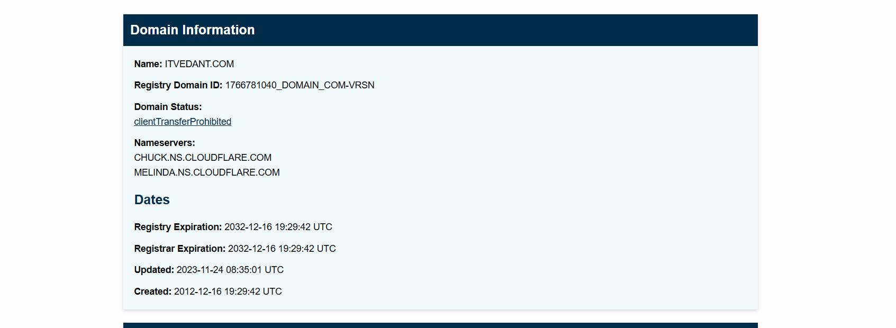
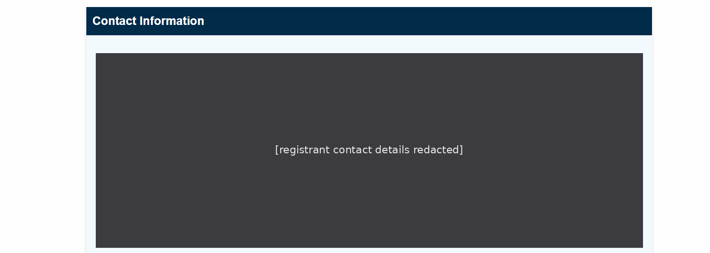
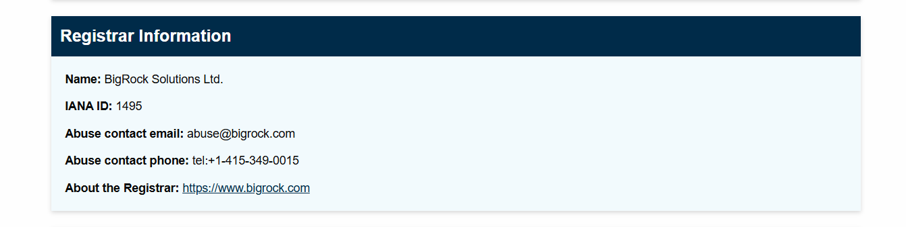
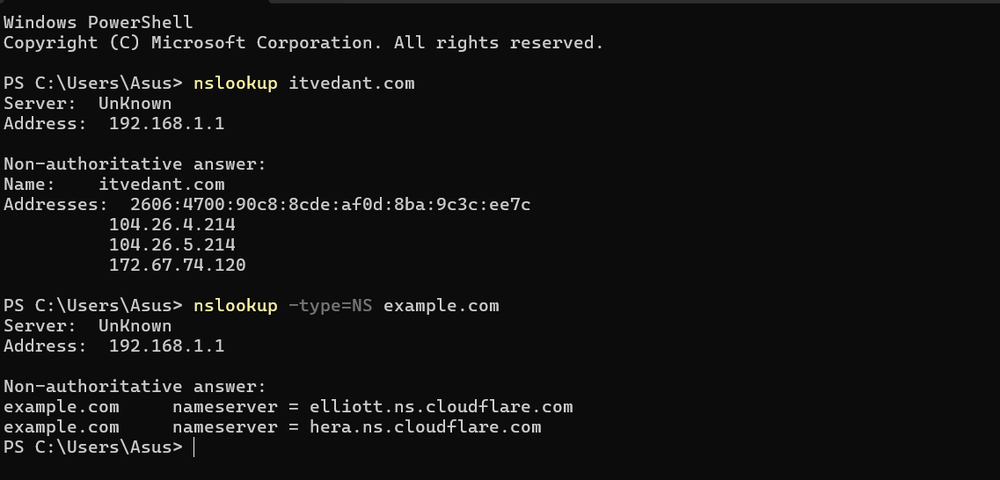
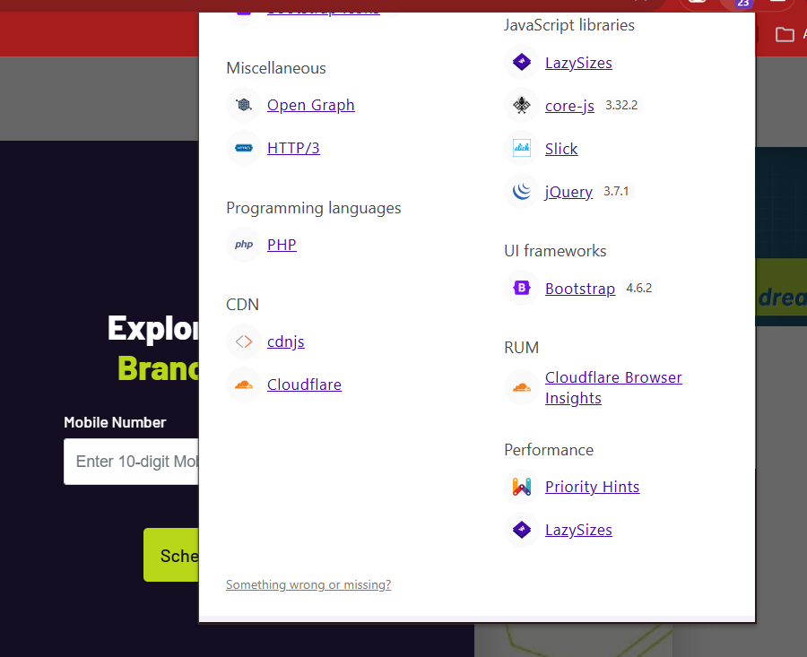

# Assignment 01: Footprinting, Reconnaissance and OSINT

The first real step in any ethical hacking job is finding out what's already public about the target, before touching anything. This assignment is that step, done only against **itvedant.com**, the website of my own training institute, and using only information anyone can see without logging in.

## Scope

- **Target:** itvedant.com
- **Allowed:** public information only (registration records, DNS answers, what the website shows)
- **Not done:** no port scans, no login attempts, no crawling beyond the public pages, nothing that touches the server itself

Stating that scope before starting is the point. Passive recon is legal for public data, but the boundary between "looking" and "testing" only holds if you decide it up front.

## Three words that get mixed up

| Term | What it means here |
|---|---|
| Footprinting | Collecting specific facts about the target: registrar, name servers, IP addresses |
| Reconnaissance | Putting those facts together to see what the target looks like from outside |
| OSINT | Open-source intelligence: information from public sources such as websites and search results |

Footprinting is the *what*, OSINT is *where it came from*, and reconnaissance is the *what it means together*.

## What I looked at

### 1. Domain registration (whois)

The registration record for itvedant.com:

| Field | Value |
|---|---|
| Registrar | BigRock Solutions Ltd. |
| Status | `clientTransferProhibited` |
| Created | 16 December 2012 |
| Expires | 16 December 2032 |
| Last updated | 24 November 2023 |

The `clientTransferProhibited` status means the domain is locked at the registrar, so it can't be moved to another company without the owner unlocking it first. That's a basic protection against domain hijacking.

The registration also lists an administrative contact with a personal name, email, phone and address. Those details are the registrant's, not mine to publish, so I've covered them:

The registrar's own abuse contact is a public business address, so it's left visible:

### 2. DNS lookup (nslookup)

The name servers for the domain are Cloudflare's:

- `CHUCK.NS.CLOUDFLARE.COM`
- `MELINDA.NS.CLOUDFLARE.COM`

Running `nslookup` on the domain returned one IPv6 and three IPv4 addresses:

| Type | Address |
|---|---|
| IPv4 | 104.26.4.214 |
| IPv4 | 104.26.5.214 |
| IPv4 | 172.67.74.120 |
| IPv6 | 2606:4700:90d8:8cde:af0d:8ba:9c3c:ee7c |

**Something to double-check.** In the screenshot the IPv6 address reads `2606:4700:90c8:8cde:...`, with `90c8` in the third group. The saved output and the report both say `90d8`. I can't run the lookup again from where this was written, so I haven't picked one. The IPv4 addresses agree in every source.

**Second lookup in the same screenshot.** The screenshot also includes `nslookup -type=NS example.com`. That's a lookup on `example.com`, a reserved example domain, not on the target. I left it in because it's in the original capture, but it doesn't tell us anything about itvedant.com.

### 3. Website and public technology (OSINT)

The website itself is public, so I looked at it the way any visitor would, and used the Wappalyzer browser extension to list the technologies it detects:

Wappalyzer reported:

- **Analytics and advertising:** Google Analytics, Google Ads, Facebook Pixel, Microsoft Clarity
- **Libraries and frameworks:** jQuery 3.7.1, Bootstrap 4.6.2, core-js 3.32.2, Slick, LazySizes
- **Infrastructure:** Cloudflare, cdnjs, HTTP/3
- **Other:** PHP, Google Font API, WhatsApp Business Chat

Knowing that a site runs jQuery 3.7.1 is useful for recon, but it doesn't mean the site is vulnerable. Versions get updated, and a version number on its own proves nothing.

## What this adds up to

The Cloudflare name servers suggest the site is behind Cloudflare, and Wappalyzer's Cloudflare detection agrees. In that setup the IP addresses that show up in DNS usually belong to Cloudflare's edge network, not to the institute's own server. So the IPs found here describe where the site is *served from*, not where it actually lives. That's a useful thing to know before drawing conclusions from them.

| What was found | What it tells an assessor |
|---|---|
| Domain and registrar | Who manages the domain, and that it's locked against transfer |
| Cloudflare name servers and IPs | DNS and traffic are routed through a CDN |
| Visible technology stack | Which libraries and services are on the front end |
| Analytics and marketing tags | Third-party services that receive visitor data |

## Attack surface

The report lists the public-facing parts: the domain, DNS, the IP addresses, and the front-end stack. I'd add one thing it doesn't say directly: every item in that list is something a real attacker can see too. That's the reason recon is done first, so you know what's visible before you decide what to test.

These findings don't show that a weakness exists. They only show where an authorized assessor would look next.

## Problems I noticed in the original report

- The second lookup in the DNS screenshot is for `example.com`, not the target. The report doesn't mention this.
- The IPv6 address differs between the screenshot and the report (see above).
- Figure 4 in the report is the same image as Figure 1. I've kept one copy.
- In the saved output (`raw_lookup_output.txt`), the `example.com` answer sits directly under the target's "Name Server" heading, so it's easy to read as if it describes itvedant.com.

## Ethical and legal notes

- Only collect information about systems you're authorized to assess. Here that was the institute's own domain.
- Public data can still be personal data. The registrant's name, phone and address are in the public record, but they don't need to go in a portfolio, so I removed them.
- Finding information doesn't give permission to access, test or disrupt anything. The next step after recon would need its own written authorization.

## What I took from this

- Passive recon is mostly reading public records and asking public DNS questions. The skill is in knowing what each answer means.
- A CDN like Cloudflare changes how you read an IP address. The address often points to the edge, not the server.
- Writing down the scope and the method first made it clear what I should *not* do, which mattered more than I expected.
- Checking numbers against the raw output caught a real mismatch, so I'd do that step every time.

## Files in this folder

| File | What it is |
|---|---|
| `README.md` | This write-up |
| `raw_lookup_output.txt` | The saved whois and DNS output the report is based on |
| `screenshots/` | Screenshots of the target domain, DNS lookup and OSINT results. The contact block is redacted. |
