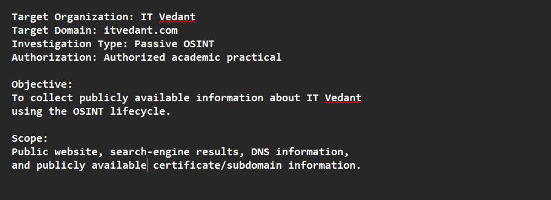
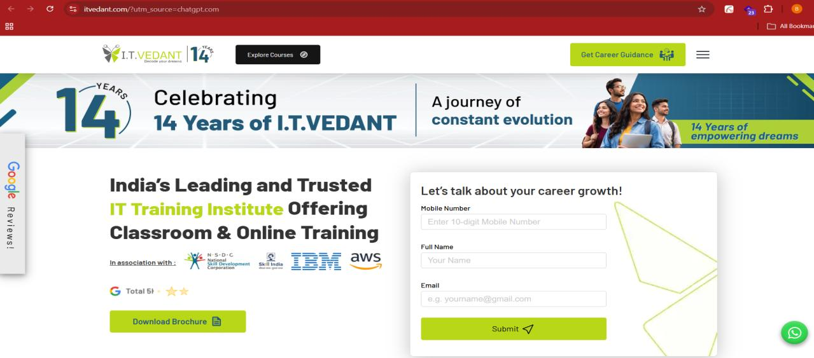
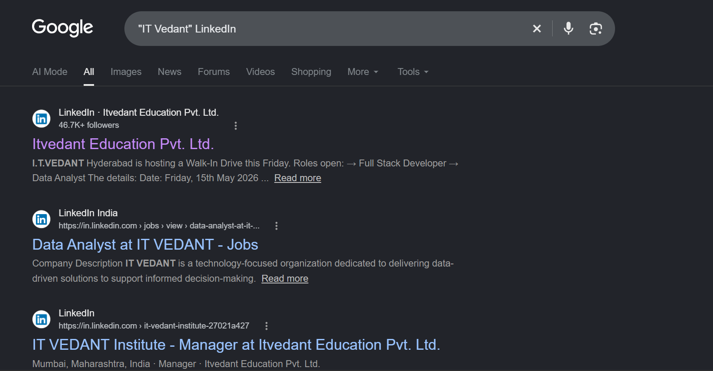
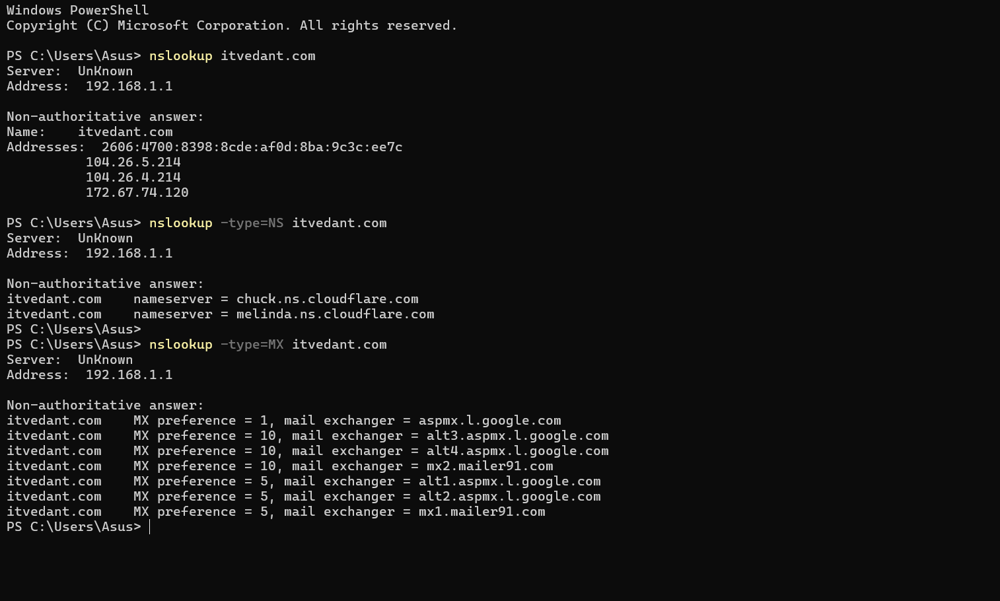
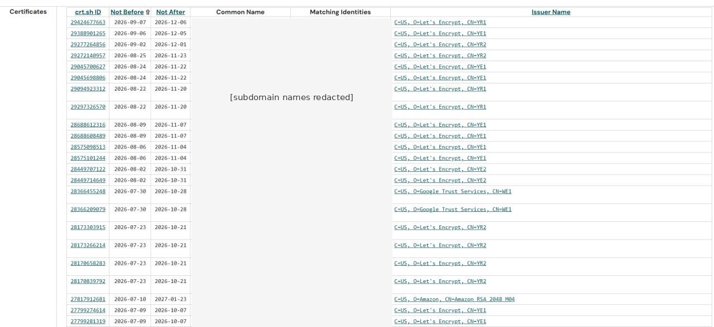

# Assignment 02: OSINT Lifecycle, Passive Investigation of IT Vedant

This one follows the OSINT lifecycle from start to finish instead of stopping at a list of findings. The steps are: plan, collect, process, analyse, report, and review. The target is the same institute as Assignment 01, itvedant.com, and everything here comes from public sources. Nothing was tested or logged into.

## 1. Planning and scope

Before collecting anything, I wrote down the target, the method and the limits:

| Item | Value |
|---|---|
| Organisation | IT Vedant |
| Domain | itvedant.com |
| Type | Passive OSINT |
| Authorisation | Academic practical |
| Scope | Public website, search results, DNS, certificate transparency records |

Writing the scope first matters because it decides what counts as "in bounds". Anything outside it, such as the server itself or the systems behind the subdomains, stays off the table.

## 2. Collection

### The official website

The homepage was checked the way a normal visitor would see it:

It shows the institute's tagline, its 14-year history, partner logos (NSDC, Skill India, IBM, AWS) and a public contact form. The contact form is one of the places a legitimate organisation invites people in, so it's worth knowing it exists.

### Search-engine results

I ran Google searches with `site:` operators and exact phrases:

- `site:itvedant.com`
- `site:itvedant.com contact`
- `site:itvedant.com career`
- `"IT Vedant" Pune`
- `"IT Vedant" LinkedIn`

The LinkedIn results show the company's **legal name, Itvedant Education Pvt. Ltd.**, a follower count of 46.7K+, and a walk-in recruitment post with the company's hiring roles. The legal name is useful later, because it's what registrations, contracts and job listings tend to use.

The results show company pages and job posts only. No individual people are named in them, so I haven't included any.

### DNS

Three queries were run with `nslookup`:

| Query | Result |
|---|---|
| `nslookup itvedant.com` | One IPv6 address and three IPv4 addresses |
| `nslookup -type=NS itvedant.com` | `chuck.ns.cloudflare.com` and `melinda.ns.cloudflare.com` |
| `nslookup -type=MX itvedant.com` | Seven mail exchangers (see below) |

**The MX records.** The report says the practical output "did not contain an MX record result, so no MX record is reported here". That isn't what the screenshot shows. The third query returns seven mail exchangers:

| Preference | Mail exchanger | Provider |
|---|---|---|
| 1 | `aspmx.l.google.com` | Google Workspace |
| 5 | `alt1.aspmx.l.google.com`, `alt2.aspmx.l.google.com` | Google Workspace |
| 5 | `mx1.mailer91.com` | Third-party mail service |
| 10 | `alt3.aspmx.l.google.com`, `alt4.aspmx.l.google.com` | Google Workspace |
| 10 | `mx2.mailer91.com` | Third-party mail service |

So the organisation sends and receives mail through Google Workspace, with a second mail provider on the side. The report text needs correcting on this point.

**The IPv6 address.** This capture reads `2606:4700:8398:8cde:...`. Assignment 01 recorded `...90d8:...` for the same domain. Both came from the same Cloudflare-hosted name, so the address probably changed between the two captures. That's normal for a CDN, and it's a good reason to record when you looked up something.

### Certificate transparency

Certificate Transparency logs are public records of every TLS certificate issued for a domain. Searching a domain there lists its certificates, and every hostname on those certificates is visible. I searched itvedant.com on crt.sh:

What the visible rows show:

- **23 certificates** across the rows visible in the capture, issued between early July and early September 2026. The table is cut off, so the full total is higher.
- **Issuers:** Let's Encrypt (several generations), Google Trust Services, and Amazon.
- **Wildcard certificates** (one for the main domain and one for a product subdomain), which cover any name under those domains.
- **About a dozen distinct hostnames** in the visible rows. They're named after product areas: APIs, front ends, an editor, notifications, OCR, a "pulse" service, and some that look like development or UAT (testing) environments.

**Why I redacted the hostnames.** The certificates are public, and anyone can search them. But collecting the full list in one place is a different thing. Names like those for test and backend systems point straight at the places an attacker would try first. Publishing them on GitHub would be handing out a target list, even though nobody has done anything wrong. So the README describes the hostnames by category and leaves the names out. The dates, issuers and certificate IDs are still visible.

The report describes this stage as "intended to be examined", which undersells what the screenshot shows. The check did return results.

## 3. Processing

Raw findings were grouped into five categories:

| Category | Findings |
|---|---|
| Organisation | Name, legal entity, courses, locations, public contact, LinkedIn presence |
| Domain | `itvedant.com`, Cloudflare name servers |
| DNS and mail | Cloudflare-fronted IPs, Google Workspace mail, a second mail provider |
| Search results | Company pages, a recruitment post |
| Certificates | Subdomain categories, wildcard coverage, issuer mix |

The categories matter more than the individual items. Grouping things this way is what turns scattered public data into a picture of the organisation.

## 4. Analysis

| Finding | What it suggests |
|---|---|
| Google Workspace for mail | The organisation uses Google's business mail. Someone planning phishing would have a clear template to imitate, so staff awareness matters. |
| Several subdomains with product-like names | Multiple services are public. Each one is a separate thing to protect. |
| Test and development hostnames | Non-production systems often get weaker controls than production. They're the first thing to check in an assessment. |
| Wildcard certificates | Any name under the wildcard is covered, so the certificate doesn't tell you which names are real. Only the explicit entries do. |
| Cloudflare DNS and CDN | The IPs in DNS are usually Cloudflare's edge, so they don't show where the application actually runs. Traffic is filtered there, which helps defenders. |

None of this shows an actual vulnerability. It shows where an authorised assessor would spend time.

## 5. Reporting

The findings were summarised in the report, with the planning, collection and analysis stages kept distinct so each claim can be traced back to its source. The report contains only public data from this practical.

## 6. Review and feedback

Looking back at the collection, three things would change next time:

- **Check the report against the screenshots before submitting.** The report says no MX records were returned, but the screenshot shows seven. It also calls the certificate check "intended", when the screenshot shows results. The fix is a quick cross-check.
- **Record when each lookup was done.** The IPv6 address changed between captures, and without a date you can't tell whether that's a change or a mistake.
- **Keep the raw output.** The `ROW DATA.txt` file in the submission is empty, so the raw DNS and whois results aren't on record. Saving each command's output as it's run would fix that.

## Ethical and legal notes

- Only the institute's own public information was used, under a stated academic authorisation.
- Certificate data is public, but publishing a list of a live organisation's internal-looking hostnames is a different decision. I've left them out of the repo.
- Search results sometimes include personal details. None appeared in this practical, and I'd remove any that did before publishing.
- Finding a name doesn't give permission to test it. Any active testing would need its own written authorisation.

## What I took from this

- The OSINT lifecycle is a loop, not a checklist. The review stage changes how the planning stage works next time.
- Public certificate data can reveal more than a website does, mainly because it lists the hostnames of services that aren't linked from anywhere.
- Checking your report against your evidence is a real step in the work, not admin. Two claims here were wrong in ways that would have misled a reader.

## Files in this folder

| File | What it is |
|---|---|
| `README.md` | This write-up |
| `screenshots/` | Planning, website, search, DNS and certificate screenshots. Certificate hostnames are redacted. |
