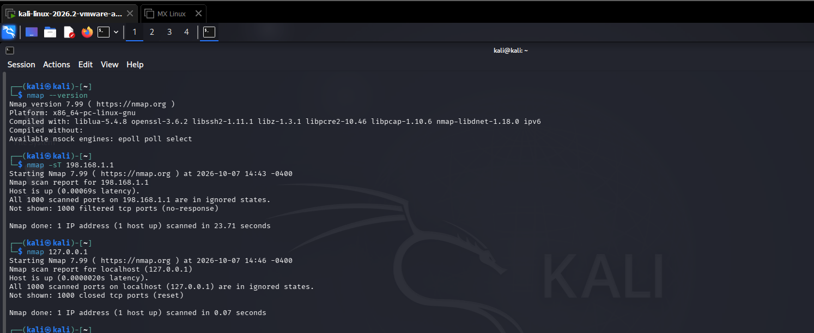
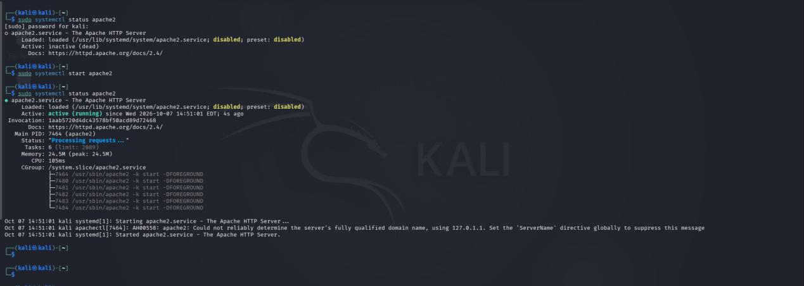
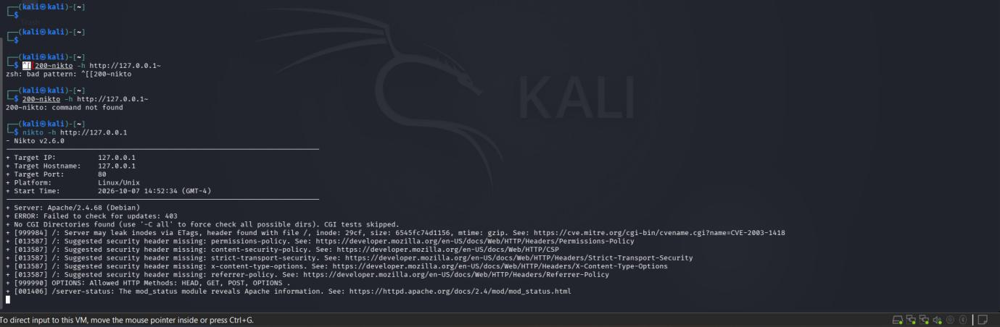
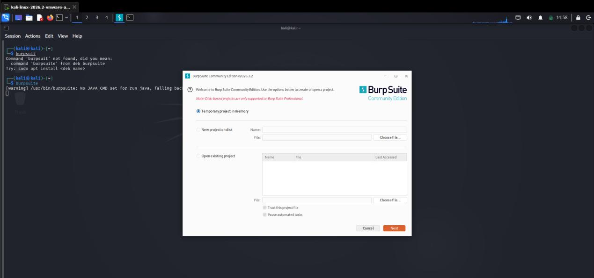
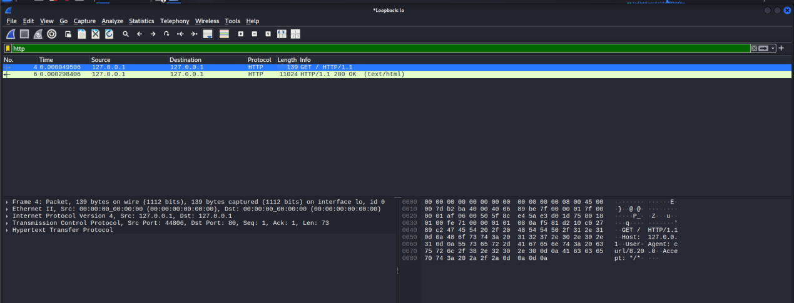
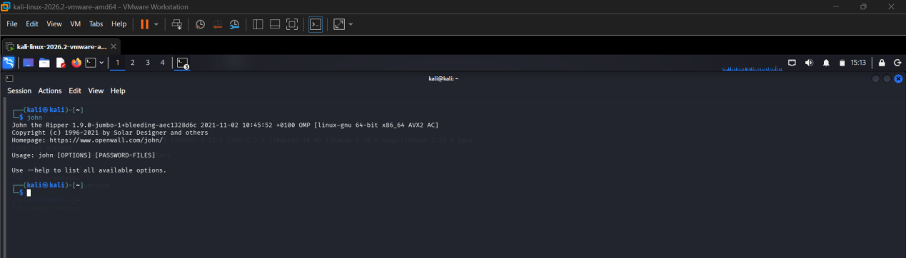

# Assignment 01: Kali Linux and Security Assessment Tools

Kali comes with hundreds of tools, so this assignment picks one from each part of an assessment and runs it against a target I control: the local machine, `127.0.0.1`. The tools are Nmap, Nikto, Burp Suite, Wireshark and John the Ripper.

Everything here was run on localhost, with one exception that I've described in full below.

## Scope

- **Allowed:** `127.0.0.1` and the local Apache web server running on it
- **Not allowed:** any other address. This is the rule I should have followed for every command in this write-up.

## The tools

| Tool | Stage | Target | What it's for |
|---|---|---|---|
| Nmap | Information gathering | 127.0.0.1 | Finding open ports and the services behind them |
| Nikto | Vulnerability analysis | http://127.0.0.1 | Checking a web server for common misconfigurations |
| Burp Suite | Web application analysis | http://127.0.0.1 | Intercepting and inspecting HTTP traffic |
| Wireshark | Sniffing and analysis | loopback interface | Capturing packets and reading protocols |
| John the Ripper | Password auditing | a test hash | Checking how easily password hashes can be guessed |

## 1. Nmap: information gathering

Nmap was checked for its version, then used for two scans:

```
nmap --version
nmap -sT 198.168.1.1      ← see the note below
nmap 127.0.0.1
```



**The localhost scan** (`nmap 127.0.0.1`) found **no open ports**. All 1000 scanned ports were closed, and the host replied with resets. For a machine with nothing listening, that's the expected result. It also shows that a scan can be correct and still find nothing.

**The other scan** targeted `198.168.1.1`. That's a typo. The address I meant was `192.168.1.1`, my home router, and the typed address is not in the private range at all. It's not what the report describes, and it's outside the target I'd agreed to. The scan reported the host as up with all ports filtered. I should have caught the typo before running it, and I'd rather say so here than leave it out.

## 2. Nikto: web server checks

Apache was started first, then Nikto was run against it:

```
sudo systemctl start apache2
nikto -h http://127.0.0.1
```




Apache started cleanly. Its status shows it running with its main process and worker threads. The log also warns that `ServerName` isn't set, which is harmless on localhost but would matter on a real server.

Nikto reported the server as **Apache/2.4.68 (Debian)** and listed these findings:

| Finding | What it means |
|---|---|
| ETags leak inode numbers | The ETag header reveals file system details, which helps an attacker map the server |
| Missing `Permissions-Policy`, `Content-Security-Policy`, `Strict-Transport-Security`, `X-Content-Type-Options`, `Referrer-Policy` | Browser security headers that would limit damage from attacks such as XSS and clickjacking are not set |
| `OPTIONS` shows allowed methods `HEAD, GET, POST, OPTIONS` | Lists what the server accepts, which is normally fine but worth knowing |
| `/server-status` is reachable | The Apache status page exposes server details, and it normally shouldn't be open to everyone |

Nikto also reported one error: it couldn't check for updates (a 403 response). That's Nikto's own update check, not a problem with the server.

These are the things the report should have explained: what Nikto found and why each one matters. The report instead says Nikto looks for "interesting files or components" in general.

## 3. Burp Suite: web application analysis

Burp was launched from the terminal:

```
burpsuite
```



**What the screenshot shows:** Burp's startup dialog, with a temporary in-memory project selected. The first attempt was misspelled (`burpsuit`) and failed with "command not found". The corrected `burpsuite` started with a warning about `JAVA_CMD`.

**What it doesn't show:** the interception itself. The report says Burp intercepted an HTTP GET request, but no captured request appears in any screenshot. Until a screenshot of an intercepted request is added, the report's claim isn't supported by the evidence.

What Burp is for: it sits between the browser and the server and lets you read and change each request and response. That's how you check things like how a login form handles bad input, or whether a session cookie is set securely.

## 4. Wireshark: traffic analysis

I captured loopback traffic while sending a request with curl:

```
curl http://127.0.0.1
```

with the display filter `http`.



The capture shows two packets:

| No. | Direction | What it is |
|---|---|---|
| 4 | 127.0.0.1 → 127.0.0.1 | `GET / HTTP/1.1` from `curl/8.20.0`, to Host `127.0.0.1` |
| 6 | 127.0.0.1 → 127.0.0.1 | `HTTP/1.1 200 OK`, `text/html`, frame length 11,024 bytes |

The packet bytes show the request in readable text. The request, including its headers, travels in plain text.

This is the most useful part of the assignment. Anyone who can see the network path can read everything in an HTTP exchange, which is why HTTPS exists. On localhost it doesn't matter, but the same plain-text traffic on a real network would expose passwords and session cookies.

## 5. John the Ripper: password auditing

John was run without arguments:

```
john
```



**What the screenshot shows:** the tool's version banner (1.9.0-jumbo-1) and its usage line. That's all.

**What it doesn't show:** the audit. The report says John cracked a test MD5 hash with a wordlist, but there's no hash file, no wordlist, and no cracking output in any screenshot. I haven't written those results in here, because they aren't in the evidence.

What John is for: it takes a file of password hashes, guesses candidate passwords (from a wordlist or by rules), hashes each guess and compares the result. A weak password falls to a dictionary attack in seconds. A strong one doesn't.

## What I'd change before publishing

- **Retake the Burp screenshot** after intercepting a request, so the claim is backed by evidence.
- **Retake the John screenshot** after running it on a test hash with a wordlist, showing the cracked result.
- **Crop or retake the Nmap screenshot** so it shows only the localhost scan, or keep the typo scan and explain it clearly as above.

## Ethical notes

- The Nmap typo sent a scan to an address that wasn't part of the target. Double-check every address before running a scan, and write the expected target down first.
- These tools are useful for defenders and for learning, but they're also used against real systems. Only run them against machines you own or have written permission to test.
- The password tested was a self-made test value. Real hashes or passwords from other people should never be used in a practical like this one.

## What I took from this

- A scan that finds nothing is still a result. The localhost Nmap scan showed that clearly.
- Nikto's real findings were more useful than any general description of what it does. The headers and the `/server-status` page are things a real assessment would flag.
- Burp and John only prove something once the evidence shows the step. Starting a tool and having it installed don't count.
- A typo in a target address is easy to make and easy to miss. Checking the target before each command is part of the job.

## Files in this folder

| File | What it is |
|---|---|
| `README.md` | This write-up |
| `screenshots/` | One image per tool, with the Apache and Nikto steps split into two |
