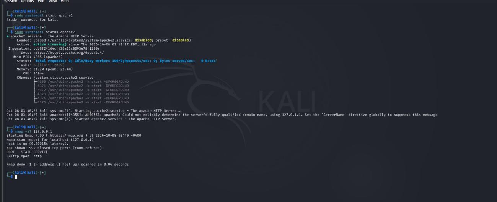
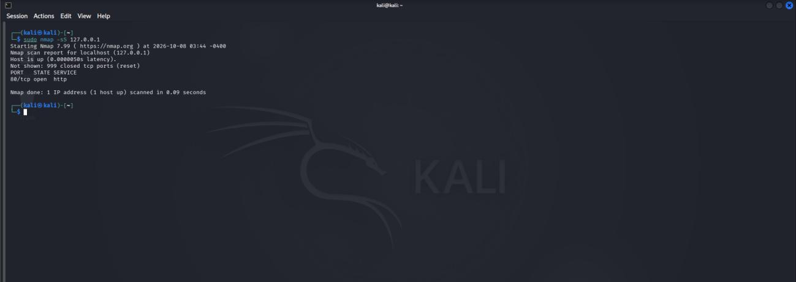
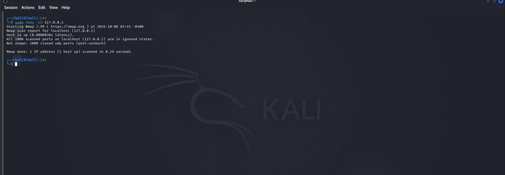
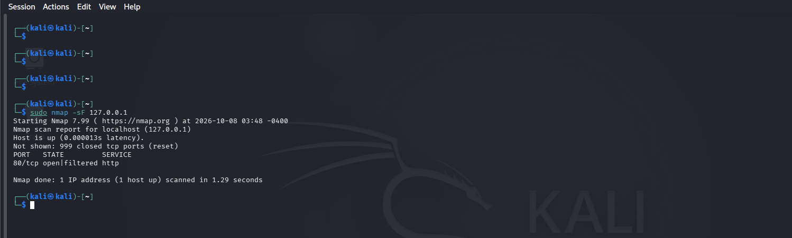
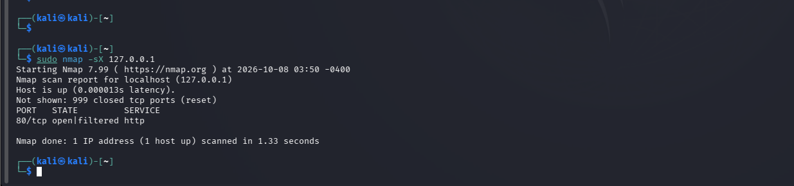
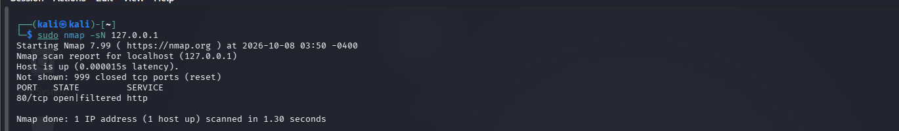
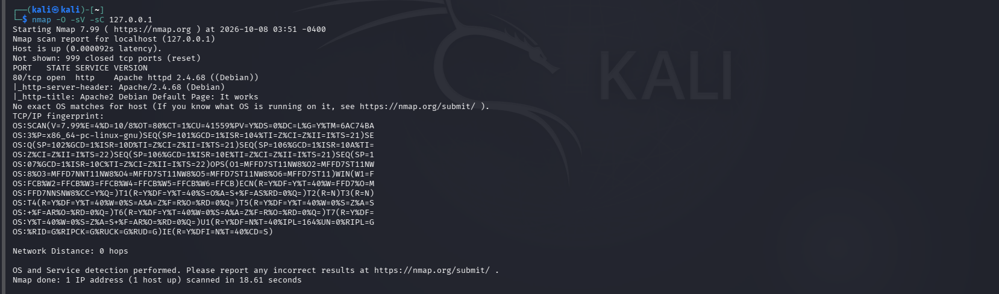

# Assignment 02: Port Scanning and Port States

Port scanning answers one question: which doors on a machine are open, closed, or unclear. This assignment runs six Nmap scan types against localhost, then one more that identifies the service and operating system behind an open port. The results are compared in a table at the end.

Everything was run against `127.0.0.1`, on the Kali VM, with Apache started first so there would be one open port to find.

## Setup

```
sudo systemctl start apache2
```

Apache was started first, so port 80 would be open. Without it, every TCP port on localhost would be closed.



## The scan types

Most of these scans need `sudo`, because they build packets by hand, which only root can do.

### 1. TCP connect scan (`-sT`)

```
nmap -sT 127.0.0.1
```

This scan does the full TCP handshake with each port. Nmap found:

- Port 80/tcp: **open**, `http`
- 999 ports: **closed**, with "connection refused"


Because it completes the handshake, this scan is the easiest to understand, and the easiest to spot in logs.

### 2. SYN scan (`-sS`)

```
sudo nmap -sS 127.0.0.1
```

This scan sends the first packet of a handshake (SYN), reads the reply, and never finishes the connection. Nmap found the same result as the connect scan: port 80 **open**, 999 ports **closed**. The difference is that the closed ports are reported as "reset" rather than "connection refused".



This is why SYN scans are the default for many tools. They're faster and leave fewer completed connections behind.

### 3. UDP scan (`-sU`)

```
sudo nmap -sU 127.0.0.1
```

UDP has no handshake, so Nmap has to send a packet and read what comes back, or nothing. Here, every one of the 1,000 scanned ports was in an "ignored" state, and the reason given for the closed ones was "port unreachable". No UDP service answered.



UDP scans are slow, because Nmap waits for replies and retries. Even so, a result like this one only means nothing answered on localhost. A DNS server or SNMP service elsewhere would behave differently.

### 4. FIN scan (`-sF`)

```
sudo nmap -sF 127.0.0.1
```

This scan sends a TCP packet with only the FIN flag set. A closed port replies with a reset. An open port, under RFC 793 behaviour, doesn't reply at all. Nmap found:

- Port 80/tcp: **open|filtered**
- 999 ports: **closed**, with "reset"



Port 80 is open, and the scan can't say so with confidence, so Nmap reports `open|filtered`. The silence is the clue.

### 5. Xmas scan (`-sX`)

```
sudo nmap -sX 127.0.0.1
```

The Xmas scan sets FIN, PSH and URG together. The reasoning is the same as the FIN scan, and the result is the same: 80 **open|filtered**, 999 **closed**.



### 6. NULL scan (`-sN`)

```
sudo nmap -sN 127.0.0.1
```

The NULL scan sends a TCP packet with no flags set. Again the same pattern: 80 **open|filtered**, 999 **closed**.



Three scans giving the same answer might look like wasted effort. On a real network it isn't. A firewall that drops stateful packets can give different answers to these three, and comparing them is how you see what the firewall is doing.

### 7. Service and OS detection (`-O -sV -sC`)

```
nmap -O -sV -sC 127.0.0.1
```

This scan goes further than finding open ports. It identifies what's behind them:

- **80/tcp open, `Apache httpd 2.4.68 ((Debian))`**
- The HTTP header and page title confirm it: `Apache2 Debian Default Page: It works`
- Nmap couldn't match the operating system exactly ("No exact OS matches")
- Network distance: 0 hops, because the target is the local machine



Note that the command includes `-O` (OS detection), which the report didn't mention. The screenshot is the only evidence for `-sV` and `-sC` here, and it shows `-O` as well.

## Port states

Nmap uses six states. Here's how they map to what was seen:

| State | Meaning | Where it showed up |
|---|---|---|
| **open** | Something is accepting connections | Port 80 in the connect, SYN and version scans |
| **closed** | Reachable, but nothing is listening | 999 ports in every scan |
| **filtered** | Something (usually a firewall) is blocking the probe, so there's no answer | Nothing here. There's no firewall on localhost. |
| **unfiltered** | Reachable, but Nmap can't tell open from closed | Only appears with the ACK scan, which wasn't run |
| **open\|filtered** | Open or filtered: Nmap can't tell which | Port 80 under FIN, Xmas and NULL |
| **closed\|filtered** | Closed or filtered: Nmap can't tell which | Nothing here |

The important one is `open|filtered`. It shows up when a scan type can't get a clear answer from an open port. Treat it as a question, not a result. The fix is to run a scan that does get an answer, like the connect scan, which said `open` for the same port.

## Comparing the scans

| Scan | Option | What it sends | What it found on port 80 | Typical use |
|---|---|---|---|---|
| TCP connect | `-sT` | Full handshake | open | Basic discovery, no root needed |
| SYN | `-sS` | SYN, then reset | open | Fast TCP discovery, the usual default |
| UDP | `-sU` | UDP probes | no UDP service found | Finding DNS, SNMP and similar services |
| FIN | `-sF` | FIN flag only | open\|filtered | Testing how a firewall handles odd packets |
| Xmas | `-sX` | FIN, PSH, URG | open\|filtered | Same as FIN, with more flags |
| NULL | `-sN` | No flags | open\|filtered | Same as FIN, with no flags |

## Corrections to the report

- **Two screenshots are labelled the wrong way round.** The image captioned "Screenshot 5: NULL Scan" shows `-sX` (Xmas). The image captioned "Screenshot 6: Xmas Scan" shows `-sN` (NULL). I've renamed the files to match what the screenshots show.
- **The `-sV -sC` section has no screenshot caption.** The image shows `-O -sV -sC`, which includes OS detection. I've described it as that.
- **The "initial scan" isn't in the screenshots.** The report says the first scan showed 1,000 closed ports before Apache was started. No screenshot shows that. The only connect scan shown is the one with Apache running.
- **One screenshot showed a home folder listing.** The NULL scan image, as captured, also showed the contents of my home directory. I cropped that out and kept the scan output. Before publishing, check the home folder for anything that shouldn't go on GitHub, especially any file holding real password hashes.

## Ethical notes

- Every scan here targeted `127.0.0.1`. Scanning another machine, even briefly, without permission can be illegal, and it's the sort of thing that gets flagged by intrusion detection.
- Results on localhost describe this Linux machine only. A remote target behind a firewall can give different answers to the same scans.
- Read the results together with the scope. An open port is a fact about the machine, not a finding about whether the machine is secure.

## What I took from this

- Each scan type is a different question. Comparing answers tells you more than any one of them.
- Silence isn't always closed. The `open|filtered` state exists because scans can't always get a reply.
- Service detection is the step that turns "port 80 is open" into something useful: Apache, on Debian, serving the default page.

## Files in this folder

| File | What it is |
|---|---|
| `README.md` | This write-up |
| `screenshots/` | One screenshot per scan type, plus the service and OS detection output. Files are named by scan type. |
