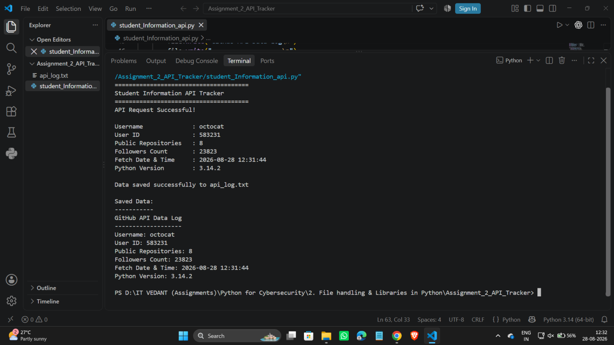
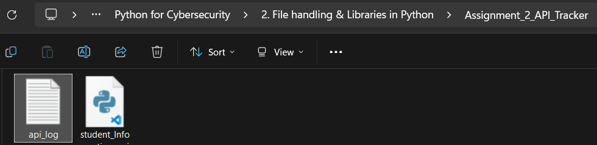
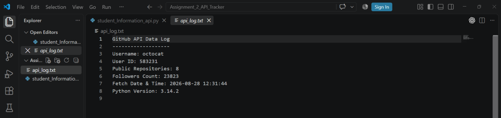

# Assignment 02 — Student Information API Tracker

In the last assignment every piece of data was typed in by me. This time it comes from the internet. The program asks GitHub's public API about a user, picks out a few details from the answer, saves them to a text file, and then reads that file back to show what was stored.

## The flow

```
GitHub API  →  GET request  →  JSON response  →  pick out the fields  →  save to api_log.txt  →  read it back  →  print
```

## The API

The program calls `https://api.github.com/users/octocat`.

`octocat` is GitHub's own demo account (it's the example user in their API docs), so it always exists. The script sends no token or key and still gets a normal response back, so no login is needed for this.

The title says "Student Information", but the data is about `octocat`, not a student. It's just a safe account to practise on.

## What gets pulled out

| Detail | Where it comes from | Value in my run |
|---|---|---|
| Username | `data["login"]` | octocat |
| User ID | `data["id"]` | 583231 |
| Public repositories | `data["public_repos"]` | 8 |
| Followers | `data["followers"]` | 23823 |
| Fetch date & time | `datetime.now()` | 2026-08-28 12:31:44 |
| Python version | `sys.version` | 3.14.2 |

The first four come from GitHub. The last two are added by the script itself.

## Libraries

- **`requests`** sends the GET request. It isn't part of Python's standard library, so it has to be installed first (`pip install requests`).
- **`datetime`** gives the timestamp.
- **`sys`** gives the Python version. `sys.version` is a long string with build details after the number, so the script keeps only the first word with `.split()[0]`, which leaves just `3.14.2`.

## How the code works

The full script is [`student_Information_api.py`](./student_Information_api.py). The main parts:

**Sending the request and checking it worked**

```python
response = requests.get(api_url)

if response.status_code == 200:
    data = response.json()
```

`200` means the request succeeded. `.json()` turns the JSON text GitHub sends back into a Python dictionary, which is why the values can be picked out by name.

**Picking out the fields**

```python
username = data["login"]
user_id = data["id"]
public_repos = data["public_repos"]
followers = data["followers"]
```

**Saving to a file, then reading it back**

```python
with open("api_log.txt", "w") as file:
    file.write("GitHub API Data Log\n")
    file.write("-------------------\n")
    file.write(f"Username: {username}\n")
    # ...same pattern for the other fields

with open("api_log.txt", "r") as file:
    saved_data = file.read()

print(saved_data)
```

The `f"..."` strings put the variables straight into the text, which is a lot tidier than joining strings with `+` like I did in the student records assignment.

**If the request doesn't succeed**

```python
else:
    print("API request failed.")
    print("Status Code:", response.status_code)
```

## Screenshots

**1. Running the program**

The terminal output has two halves. The top half is the live values printed straight after the request. The bottom half, under `Saved Data:`, is the same information read back from `api_log.txt`. The two match.



**2. The file appearing**

After the run, `api_log` shows up in the folder next to the script. The script creates it when it first writes.



**3. What's inside it**

Eight lines: a title, a dashed line, then the six details.



## Things I noticed

- **It's a snapshot, not a running log.** The file is opened with `"w"`, so every run replaces what was there. It only ever holds the latest fetch, even though the file is called a log. Switching to `"a"` would keep a history, one entry per run. The numbers also only describe one moment: 23,823 followers is the count at 12:31:44 on 28 August 2026, and it will have changed since.
- **Only half of the failure cases are handled.** If GitHub answers with an error code (a `404` for a username that doesn't exist, for example), the `else` branch prints `API request failed.` and the status code. But if there's no internet connection, `requests.get()` raises an error before the `if` is even reached. Nothing catches it, so the script stops with a traceback. A `try/except` around the request would cover that.
- **There's no timeout.** `requests.get(api_url)` doesn't set one, so a server that never answers could leave the program waiting. Adding `timeout=10` is the usual fix.
- **It could point at any user.** Swapping `octocat` in the URL for another username (my own, say) is all it would take to make the tracker about someone real.

## Files in this folder

| File | What it is |
|---|---|
| `student_Information_api.py` | The script |
| `api_log.txt` | The file the script generated on my run |
| `screenshots/` | Screenshots of the run and the generated file |
