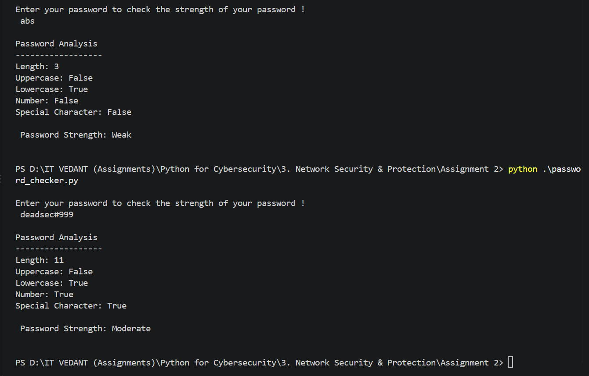
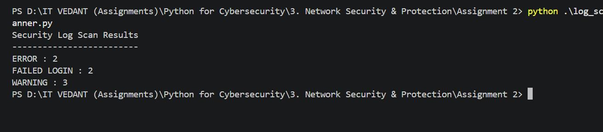
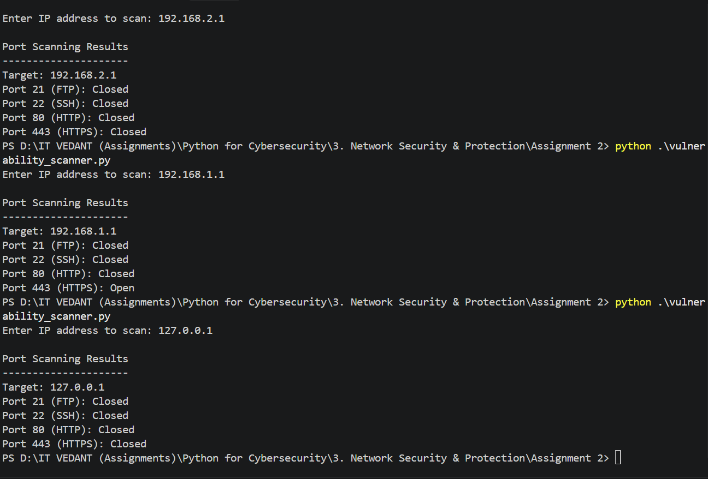

# Assignment 02 — Cybersecurity Automation Toolkit

Three small Python tools that automate checks a security person would otherwise do by hand: rating a password, counting warning signs in a log file, and seeing which common ports on a machine accept connections. One script each, and only Python's built-in modules are used.

## The three tools

| Tool | Script | What it does | Built-in module |
|---|---|---|---|
| Password strength checker | [`password_checker.py`](./password_checker.py) | Scores a password on five checks | `string` |
| Log scanner | [`log_scanner.py`](./log_scanner.py) | Counts `ERROR`, `FAILED LOGIN` and `WARNING` lines in a log file | none |
| Port scanner | [`vulnerability_scanner.py`](./vulnerability_scanner.py) | Checks whether ports 21, 22, 80 and 443 accept a connection | `socket` |

---

## 1. Password strength checker

The script gives a password one point for each of five checks: at least 8 characters, an uppercase letter, a lowercase letter, a digit, and a special character.

```python
has_upper = any(char.isupper() for char in password)
has_lower = any(char.islower() for char in password)
has_number = any(char.isdigit() for char in password)
has_special = any(char in string.punctuation for char in password)
```

| Score | Result |
|---|---|
| 0 – 2 | Weak |
| 3 – 4 | Moderate |
| 5 | Strong |



Two runs in the screenshot:

- `abs` is 3 characters with only lowercase letters, so it gets 1 point and comes out **Weak**.
- `deadsec#999` is 11 characters with lowercase, a number and a special character. That's 4 points, so it's **Moderate**. The only thing missing for Strong is an uppercase letter.

**Two things I noticed**

- It measures variety, not strength. `Password1!` ticks all five boxes and scores **Strong**, even though it's one of the first passwords anyone would guess. Length and unpredictability matter far more than the character types, and this script knows nothing about common passwords.
- `input()` shows the password on screen as it's typed (you can see it in the screenshot). Python's `getpass` module hides the typing, which is what a real tool should use.

---

## 2. Log scanner

The script reads [`security_log.txt`](./security_log.txt) line by line, converts each line to uppercase so the match ignores case, and adds 1 to a counter whenever a line contains one of the keywords.

```python
keywords = ["ERROR", "FAILED LOGIN", "WARNING"]

try:
    with open(file_name, "r") as file:
        for line in file:
            line = line.upper()

            for keyword in keywords:
                if keyword in line:
                    counts[keyword] += 1
    ...
except FileNotFoundError:
    print("Error: security_log.txt was not found.")
```

The sample log has 10 lines:

| Line type | Lines in the file | Counted by the scanner? |
|---|---|---|
| `ERROR` | 2 | yes |
| `FAILED LOGIN` | 2 | yes |
| `WARNING` | 3 | yes |
| `INFO` | 3 | no, it isn't in the keyword list |



The output (`ERROR : 2`, `FAILED LOGIN : 2`, `WARNING : 3`) matches the file line for line.

**Things worth knowing**

- It counts **lines**, not occurrences. A line containing `ERROR` twice still adds just 1.
- Matching ignores case, so `error` counts as well.
- `FAILED LOGIN` has to match as a phrase. A line like `Database connection failed` is not counted as a failed login.
- The file is looked up relative to wherever the script is run from. Run it from a different folder and you get the "not found" message even though the file exists.

---

## 3. Port scanner

For each port in the list, the script opens a TCP socket, waits up to 1 second, and tries `connect_ex()`. A result of `0` means the connection was accepted, so the port is reported **Open**. Anything else is reported **Closed**.

```python
ports = {
    21: "FTP",
    22: "SSH",
    80: "HTTP",
    443: "HTTPS"
}

for port, service in ports.items():
    sock = socket.socket(socket.AF_INET, socket.SOCK_STREAM)
    sock.settimeout(1)

    result = sock.connect_ex((target, port))

    if result == 0:
        print(f"Port {port} ({service}): Open")
    else:
        print(f"Port {port} ({service}): Closed")

    sock.close()
```



Three scans, all against private or local addresses:

| Target | 21 FTP | 22 SSH | 80 HTTP | 443 HTTPS |
|---|---|---|---|---|
| `192.168.2.1` | Closed | Closed | Closed | Closed |
| `192.168.1.1` | Closed | Closed | Closed | **Open** |
| `127.0.0.1` | Closed | Closed | Closed | Closed |

`192.168.1.1` is the default gateway from my earlier `ipconfig` screenshots, so the open HTTPS port is most likely the router's web admin page. Nothing is listening on my own machine for these four ports, which is why `127.0.0.1` is all Closed.

**Things worth knowing**

- **"Closed" really means "didn't accept my connection".** The script only checks for `0`. A port that actively refuses the connection and a connection that simply times out both come back as non-zero, and both print `Closed`. So a firewalled port, or an address with no device behind it at all, looks the same as a genuinely closed port. That could be the case for `192.168.2.1` above.
- **Open isn't the same as vulnerable.** The script only shows that something is listening. Calling it a "vulnerability scanner" is generous. It's really the first recon step: what's exposed?
- **When something is listening, it does show Open.** Starting a listener on ports 22 and 443 of localhost makes exactly those two show as Open and the other two as Closed.
- **It's slow on silent hosts.** Ports are checked one after another with a 1-second timeout, so a target that never answers takes about 4 seconds.
- **Bad input crashes it.** Typing something that isn't an IP address or a resolvable name ends in an uncaught `socket.gaierror` error.
- **Only scan what I'm allowed to scan.** Machines I own or have permission to test, even with a tool this small.

---

## Files in this folder

| File | What it is |
|---|---|
| `password_checker.py` | Password strength checker |
| `log_scanner.py` | Log keyword scanner |
| `vulnerability_scanner.py` | Basic TCP port scanner |
| `security_log.txt` | The sample log the scanner reads |
| `screenshots/` | One screenshot per tool |
